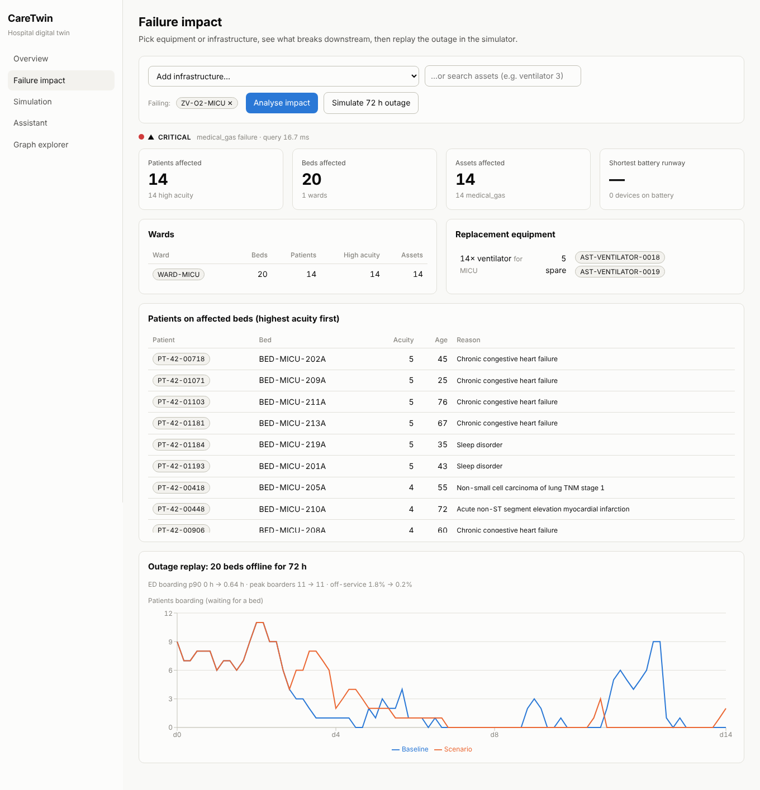
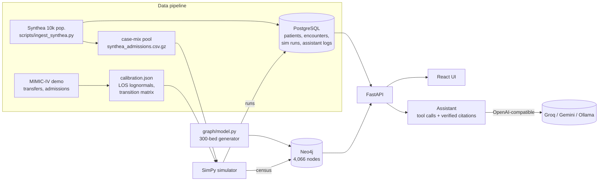

# CareTwin — Digital Twin for Hospital Operations

CareTwin models a **300-bed acute-care hospital** as a property graph of wards, rooms, beds, staff,
equipment, and the power, medical-gas, and network infrastructure they depend on. A discrete-event
**patient-flow simulator** fills the beds: Synthea provides the patient mix, and length-of-stay and
transfer patterns are fitted on MIMIC-IV. On top of that sit three tools:

* **failure-impact analysis**: "what breaks if this oxygen valve / panel / ventilator fails?"
* **what-if simulation**: arrival surges and bed outages, compared against a baseline run.
* **an LLM assistant**: calls graph tools and returns answers with citations it has checked against the tool outputs.

Stack: **React + TypeScript** (Vite, Recharts) · **FastAPI** · **Neo4j 5** · **PostgreSQL 16** ·
SimPy · Docker · **Terraform (AWS ECS Fargate, RDS, ALB, EFS)** · **GitHub Actions**.



---

## Results

All numbers below were produced by scripts in this repo on a single 4-vCPU machine that ran
Neo4j, Postgres, the API and the load generator at the same time. Raw outputs are in
[`docs/results/`](docs/results) and [`eval/results/`](eval/results).

| Area | Result |
|---|---|
| Hospital model | 300 inpatient beds across 14 wards, plus 24 ED bays, 12 PACU bays and 8 operating rooms |
| Graph size | 4,066 structural nodes and 11,153 relationships, plus ~267 `Patient` nodes from the live census (≈4,333 total) |
| Synthetic population | 11,509 Synthea patient records (10,000 alive, 1,509 deceased); 9,629 inpatient admissions in the case-mix pool; 24,935 encounters in Postgres |
| Flow calibration | MIMIC-IV Clinical Database Demo v2.2: 100 patients, 275 admissions, 687 unit-stay segments |
| Failure-impact query latency | **17.9 ms p95** (p50 9.4 ms, p99 38.5 ms) over 1,092 warm, sequential queries on 364 targets |
| Assistant accuracy (offline planner) | **50/50** on the main question set; **19/20** on a held-out paraphrase set; 100% of answers with verified citations |
| Assistant accuracy (LLM, Groq `openai/gpt-oss-120b`, first run) | **34/50** (68%) main set, **14/20** (70%) held-out; 74% / 80% of answers with verified citations |
| Tests | **200 tests** (195 pytest + 5 Vitest), **93% backend line coverage**; CI enforces ≥85% |
| Load test, 100 users, 1–3 s think time | **37 ms p95**, 0 failures, 11.4k requests at 64 req/s (`/api/impact` p95 97 ms over HTTP) |
| Load test, 100 users, no think time | 610 ms p95 at 308 req/s, 0 failures (saturation point of the single host) |
| Infrastructure as code | Terraform for AWS ECS Fargate, RDS, ALB, EFS and ECR passes `terraform validate` and `fmt`; CI and manual deploy workflows included (not applied to a live AWS account) |

The LLM run uses the same questions, gold answers and grader as the offline planner
(`.github/workflows/llm-eval.yml`, raw output in `eval/results/groq_gpt_oss_120b_*run1.json`).
About a dozen of its misses were formatting: the model wrote ids with Unicode hyphens
(`CKT‑MICU‑03`), CJK brackets or several ids in one bracket, so correct answers failed citation
checks. The rest were real errors: wrong counts (e.g. 50 instead of 58 affected patients), two
large failure scenarios that ran out of tool-call rounds, and one provider parsing error. After
that run the assistant now normalises citation formatting, allows 8 tool rounds and retries
malformed generations; re-run the workflow to score the updated version.

**Simulation fidelity** ([`docs/results/sim_validation.json`](docs/results/sim_validation.json), 10 seeds × 28 days):

| Metric | Target / reference | Simulated |
|---|---|---|
| Hospital occupancy | 85% design target | **83.8% ± 3.1%** |
| Hospital length of stay | MIMIC demo: mean 6.9 d, median 4.9 d | mean 4.6 d, median 3.2 d |
| LOS distribution | two-sample KS vs MIMIC demo | **D = 0.19** (p < 0.001) |
| ED boarding p90 | — | 8.3 h |

The simulator's length of stay is **shorter** than the MIMIC demo's, and the KS test rejects
"same distribution." That's expected for three reasons:

1. The demo cohort was sampled from ICU patients.
2. The simulator down-weights ICU transfers so a 58-ICU-bed hospital isn't permanently full (the fitted `icu_transfer_correction` is 0.85).
3. Stays still open when a run ends are excluded (right-censoring).

Read it as *calibrated to capacity, informed by MIMIC*, not as a validated clinical model.

---

## Architecture



### The graph

| Label | Count | Notes |
|---|---:|---|
| Staff | 1,671 | 18 ward rosters + hospital-wide roles; shifts, on-duty flag, certifications (ACLS, CCRN, VENT, CRRT, …) |
| Asset | 1,574 | 29 kinds: ventilators, infusion pumps, monitors, dialysis, CT/MRI…; status, PM date, battery runway |
| Bed | 344 | 300 inpatient + ED/PACU/OR care spaces |
| Room | 271 | |
| Infrastructure | 164 | utility feed, 2 generators, 2 transfer switches, 4 UPS, 21 branch panels, 89 circuits, O₂ + medical-air sources and 26 zone valves, 2 core + 14 floor network switches |
| Ward / Floor / Hospital / Shift / Certification | 18 / 8 / 1 / 3 / 12 | |

Relationships: `IN_ROOM`, `IN_WARD`, `ON_FLOOR`, `WORKS_IN`, `HAS_CERT`, `WORKS_SHIFT`, `ASSIGNED_TO`,
`STATIONED_IN`, `OCCUPIES`, and `DEPENDS_ON {required}`.

**Failure semantics:** a node fails if any *required* dependency fails, or if *all* of its redundant
(`required:false`) sources fail. Transfer switches, for example, are fed by the utility **or** a
generator, so losing Generator 2 alone changes nothing, but losing utility power **and** Generator 2
takes down the whole critical branch.

Each impacted device gets an impact **mode**:

* `equipment`: the device itself failed.
* `power`: battery runway is reported.
* `medical_gas`
* `network`: central monitoring is lost, but the device still works at the bedside.

Replacement equipment is ranked with life-support devices first, and same-ward units before other wards.

### Patient-flow simulator (`backend/app/sim`)

**From MIMIC-IV demo `transfers` (`calibration.py`):**
* Unit stays: lognormal per unit type, partially pooled toward the overall distribution when a unit has few samples.
* ED workup time.
* A smoothed unit-to-unit transition matrix, including discharge.
* Arrival-hour profile.

**From Synthea (`synthea.py`):** encounters are mapped to unit types with SNOMED-text rules, linked
ED → inpatient within 24 h, and classified as ED, elective, or direct admissions.

**Engine (`engine.py`, SimPy):**
* Arrivals follow a non-homogeneous Poisson process.
* Patients are placed in the **actual bed ids from the graph**, using FIFO queues per unit type.
* Patients hold their current bed while waiting for a transfer bed (blocking).
* General-ward patients go to another general ward after 8 h waiting (off-service).
* Elective surgical patients pass through PACU.
* Beds can be taken offline mid-run.
* Runs start from a length-biased warm start.

**`fit_rates()`:** fits the arrival rate, per-unit case-mix weights, and an ICU-transfer correction,
using damped multiplicative updates until every unit runs near 85%. This corrects Synthea's skewed
inpatient mix (42% oncology) and the ICU enrichment of the MIMIC demo. Output: [`data/calibration/sim_fit.json`](data/calibration/sim_fit.json).

Simulations are reproducible: the same seed gives byte-identical KPIs in any process.

### Assistant (`backend/app/assistant`)

* **11 graph tools** in OpenAI function-calling format (`tools.py`). The REST API uses the same query functions.
* **`OpenAICompatAgent`** works with any OpenAI-compatible endpoint (multi-round tool loop, temperature 0):
  * **Groq** free tier
  * **Google Gemini** (OpenAI-compatible endpoint)
  * **Ollama** locally
  * OpenRouter or OpenAI
* **`OfflinePlanner`** is a deterministic intent parser with templated answers. It's the default, needs
  no key, and is used by CI. If the LLM call fails, the API falls back to it.
* **Citation verification:** each `[NODE-ID]` in an answer must appear in that turn's tool outputs.
  Unverified ids are dropped, and the answer is flagged `grounded:false`.

---

## Quick start

### Everything in Docker

```bash
docker compose up --build
```

Then open:
* UI: http://localhost:8080
* API docs: http://localhost:8000/docs

On first start the API seeds the graph and the census automatically (`CARETWIN_AUTOSEED=1`).

### Local development

```bash
docker compose up -d neo4j postgres
```

```bash
python -m venv .venv && . .venv/bin/activate && pip install -r backend/requirements-dev.txt
```

```bash
cd backend && python -m app.seed && uvicorn app.main:app --reload
```

```bash
cd frontend && npm install && npm run dev
```

The dev UI runs at http://localhost:5173 and proxies `/api` to port 8000.

### Use a free LLM for the assistant

```bash
export CARETWIN_LLM_PROVIDER=openai_compat
export CARETWIN_LLM_BASE_URL=https://api.groq.com/openai/v1
export CARETWIN_LLM_MODEL=llama-3.3-70b-versatile
export CARETWIN_LLM_API_KEY=<your free Groq key from console.groq.com>
```

* **Gemini:** set `CARETWIN_LLM_BASE_URL=https://generativelanguage.googleapis.com/v1beta/openai/` and `CARETWIN_LLM_MODEL=gemini-2.0-flash`.
* **Ollama:** set `CARETWIN_LLM_BASE_URL=http://localhost:11434/v1` and `CARETWIN_LLM_MODEL=llama3.1` (no key needed).

To score the LLM on the same 50 questions:

```bash
python eval/run_eval.py
```

---

## Reproducing the data and every number

| Step | Command | Output |
|---|---|---|
| Synthea population (Java 17+) | `java -jar synthea-with-dependencies.jar -p 10000 -s 42 -cs 42 --exporter.csv.export=true --exporter.fhir.export=false --exporter.years_of_history=5 Massachusetts` | `output/csv/*.csv` |
| Ingest Synthea | `python scripts/ingest_synthea.py --csv-dir <synthea>/output/csv` | Postgres tables + `data/calibration/synthea_admissions.csv.gz` |
| Calibrate on MIMIC | `python scripts/calibrate_mimic.py` (demo files are vendored in `data/external/`) | `data/calibration/mimic_demo_calibration.json` |
| Full MIMIC-IV (if credentialed) | `python scripts/calibrate_mimic.py --mimic-dir /path/to/mimic-iv/3.1 --label "MIMIC-IV v3.1"` | same file; do **not** commit the raw data |
| Fit simulator to capacity | `cd backend && python -c "import json; from app.sim.engine import fit_rates, FIT_PATH; FIT_PATH.write_text(json.dumps(fit_rates(days=28, iterations=14, reps=4, damping=0.5), indent=2))"` | `data/calibration/sim_fit.json` |
| Seed Neo4j + Postgres | `cd backend && python -m app.seed` | graph + census |
| Tests + coverage | `cd backend && pytest --cov=app` · `cd frontend && npm test` | 195 + 5 tests |
| Assistant eval | `python eval/build_gold.py && python eval/run_eval.py && python eval/run_eval.py --questions eval/questions_heldout.jsonl` | `eval/results/*.json` |
| Impact benchmark | `python scripts/bench_impact.py` | `docs/results/impact_benchmark.json` |
| Simulator validation | `python eval/validate_sim.py` | `docs/results/sim_validation.json` |
| Load test | `uvicorn app.main:app --workers 4` then `locust -f loadtest/locustfile.py --headless -u 100 -r 20 -t 3m --host http://localhost:8000 --csv loadtest/results/run` (add `STRESS=1` for no think time) | `loadtest/results/`, `docs/results/load_test.json` |

---

## Deploying to AWS (optional, costs money)

`infra/terraform` creates:
* a VPC with public subnets (**no NAT gateway**, to save about $32/month);
* an ALB that routes `/api/*` to the API and everything else to the web container;
* ECS Fargate services for the API (autoscaling 2–6 on CPU), web (nginx), and Neo4j (single task, EFS-backed `/data`, Cloud Map DNS);
* RDS Postgres on `db.t4g.micro` (free tier for 12 months on new accounts);
* Secrets Manager, ECR with scan-on-push, CloudWatch logs;
* a **GitHub OIDC deploy role**, so no long-lived AWS keys are needed.

Estimated cost while running: **~$40–80/month**, mostly the ALB, Fargate, and EFS. Run `terraform destroy` when finished.

1. Create an S3 bucket for state and uncomment the `backend "s3"` block in `infra/terraform/versions.tf`.
2. Run the first apply locally:

   ```bash
   cd infra/terraform && terraform init && terraform apply
   ```

3. In GitHub, set secret `AWS_DEPLOY_ROLE_ARN` to the `github_deploy_role_arn` output, and optionally set variable `AWS_REGION`.
4. Run **Actions → Deploy to AWS ECS → Run workflow**. It builds and pushes both images, applies Terraform with the commit SHA as the image tag, and smoke-tests `/health`.
5. To use an LLM in the cloud, put the key in the `caretwin/dev/app` secret under `CARETWIN_LLM_API_KEY`, then apply with `-var llm_provider=openai_compat`.

CI (`.github/workflows/ci.yml`) runs on every push:
* ruff, pytest with a coverage gate, both assistant evals, and the impact benchmark (against Neo4j and Postgres service containers);
* the frontend typecheck, tests, and build;
* `terraform fmt` and `validate`;
* Docker builds of both images.

---

## Honest caveats

* **Assistant eval bias.** One author wrote the offline planner and the 50 questions. Gold values
  come from independent hand-written Cypher (`eval/build_gold.py`), not from the code under test.
  The **held-out paraphrase set** was frozen before tuning and never tuned on; its one miss
  ("life-safety **ATS**") is left visible deliberately. The 50/50 includes one bug fix made after
  the first run: zero-count answers weren't citing a node. The first run scored 49/50.
* **The hospital is synthetic.** The layout, staffing ratios and equipment counts are plausible
  assumptions, not data from a real facility. Staff names are randomly generated.
* **MIMIC demo ≠ MIMIC-IV.** 100 ICU-enriched patients. Re-run `calibrate_mimic.py` on full MIMIC-IV
  (credentialed access) for a defensible calibration.
* **Synthea timing is not used.** Synthea's encounter durations are templated (most ED visits are
  exactly 1 h) and its hour-of-day profile is flat. Synthea supplies only the case mix.
* **Single-host benchmarks.** Latency figures share 4 vCPUs between the database, the API and
  Locust. Numbers on AWS will differ.

## Repository layout

```
backend/app/graph      hospital generator, Neo4j loader, Cypher queries (impact, search, staff, assets)
backend/app/sim        MIMIC calibration, Synthea case mix, SimPy engine + capacity fitting
backend/app/assistant  tool specs, OpenAI-compatible agent, offline planner, citation verification
backend/app/api        FastAPI routes          backend/tests   pytest suite (unit + Neo4j/Postgres integration)
frontend/              React + TS UI           infra/terraform AWS ECS/RDS/ALB/EFS/ECR/OIDC
eval/                  gold builder, 50 + 20 questions, scorer, simulator validation
scripts/               data ingest, calibration, impact benchmark      loadtest/  Locust scenario + results
data/calibration       committed model inputs  data/external   MIMIC-IV demo subset (ODbL, with checksums)
```

## Data licences

* **Synthea**: Apache-2.0; the output is synthetic.
* **MIMIC-IV Clinical Database Demo v2.2**: ODbL v1.0, Johnson et al., PhysioNet (see `data/external/mimic-iv-demo-2.2/README.md`).
